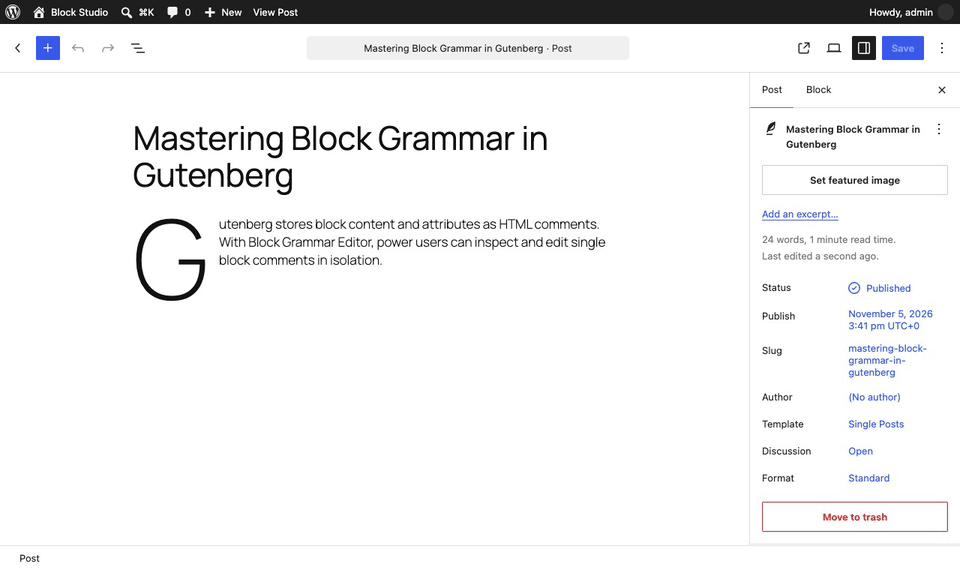
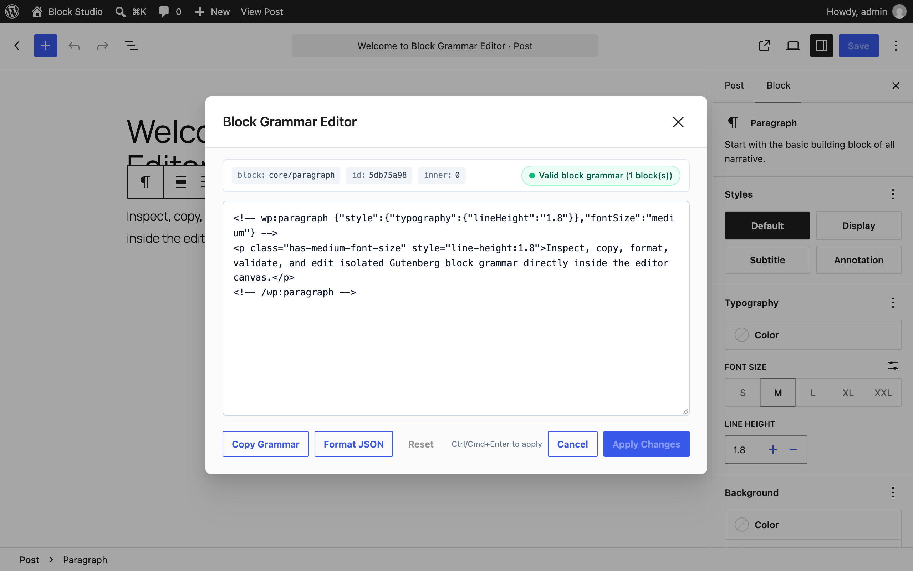
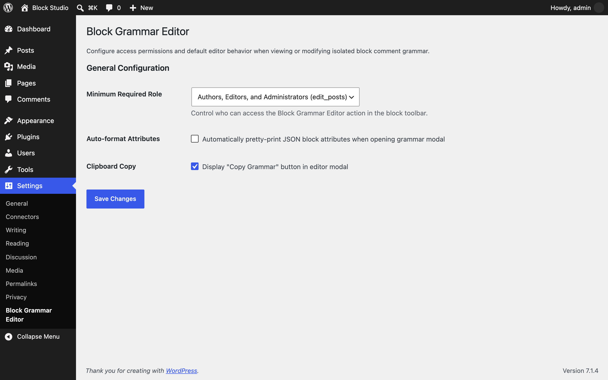

<p align="center"></p>

<h1 align="center">Pratiks Block Grammar Editor</h1>

<p align="center">
  <a href="https://playground.wordpress.net/?blueprint-url=https://raw.githubusercontent.com/pratik-londhe4/pratiks-block-grammar-editor/main/blueprint.json"></a>
  <a href="https://github.com/pratik-londhe4/pratiks-block-grammar-editor/releases/latest"></a>
  
  
  <a href="LICENSE.md"></a>
  <br>
  <a href="https://github.com/pratik-londhe4/pratiks-block-grammar-editor/actions/workflows/phpcs.yml"></a>
  <a href="https://github.com/pratik-londhe4/pratiks-block-grammar-editor/actions/workflows/phpstan.yml"></a>
  <a href="https://github.com/pratik-londhe4/pratiks-block-grammar-editor/actions/workflows/unit-tests.yml"></a>
  <a href="https://github.com/pratik-londhe4/pratiks-block-grammar-editor/actions/workflows/e2e-tests.yml"></a>
  <a href="https://github.com/pratik-londhe4/pratiks-block-grammar-editor/actions/workflows/plugin-check.yml"></a>
</p>

<p align="center">Inspect, copy, format, validate, and edit Gutenberg block comment grammar for individual blocks in the editor.</p>

<p align="center">
  
</p>

---

WordPress Gutenberg stores layout structures, block styles, and attributes inside structured HTML comments (`<!-- wp:blockName {...} -->...<!-- /wp:blockName -->`). Until now, working with block grammar meant choosing between two extremes:

1. Switching the **entire post** into Code Editor mode (`Ctrl+Shift+Alt+M`), which displays every block on the page in a giant raw text buffer and makes it easy to accidentally break unrelated blocks.
2. Selecting **"Edit as HTML"** on a block, which completely strips the Gutenberg comment grammar and converts the block into raw inner HTML, destroying attributes, inner blocks, and dynamic behaviors.

**Pratiks Block Grammar Editor** gives you an isolated, distraction-free grammar editor directly in the Gutenberg block toolbar.

> [!NOTE]
> Free and open source under GPLv2+. No pro version, no upsells, no ads, no telemetry. Clean, lightweight, and accessible.

## Features

- **Isolated block grammar editor**: Access the editor directly from the "More Options" menu in the block toolbar.
- **Syntax validation**: Real-time validation checks for unclosed tags, malformed JSON attributes, and parser errors on every keystroke. Prevents broken blocks before applying.
- **One-click clipboard copy**: Copy raw block comments with one click to easily paste into patterns, documentation, or codebases.
- **Pretty-print JSON**: One-click formatting tidies block comment JSON attributes into readable, multi-line format while preserving inner HTML.
- **Safe replacements**: Applies changes safely using native Gutenberg block replacement routines and history stack (undo/redo supported).
- **Keyboard shortcuts**: Press `Cmd/Ctrl + Enter` to apply changes instantly or `Escape` to close.
- **Role-based permissions**: Control who can access grammar editing under **Settings > Block Grammar Editor** (authors/editors or admins).
- **WP-CLI support**: Inspect and validate post block grammar directly from the terminal via `wp pratiks-block-grammar-editor inspect` and `validate`.
- **WordPress 6.9+ Abilities API & MCP**: Ready for autonomous AI agents and MCP workflows with discoverable `parse-grammar` and `validate-grammar` abilities.
- **Accessibility**: 100% WCAG 2.1 AA compliant, tested with axe-core.

## Installation

1. Download `pratiks-block-grammar-editor.zip` from the [latest release](https://github.com/pratik-londhe4/pratiks-block-grammar-editor/releases/latest).
2. In WordPress, go to **Plugins > Add New Plugin > Upload Plugin**, choose the zip and activate it.

Or with WP-CLI:

```sh
wp plugin install https://github.com/pratik-londhe4/pratiks-block-grammar-editor/releases/latest/download/pratiks-block-grammar-editor.zip --activate
```

Requires WordPress 6.6+ and PHP 7.4+. The **Try in WordPress Playground** badge runs a throwaway WordPress site directly in your browser with the plugin active and ready to test.

## WP-CLI

Inspect post block grammar or validate raw block markup from the command line:

```sh
# Inspect all blocks in post 123
wp pratiks-block-grammar-editor inspect 123

# Inspect a specific block by zero-based index as raw grammar
wp pratiks-block-grammar-editor inspect 123 --block=0 --format=raw

# Inspect as JSON representation
wp pratiks-block-grammar-editor inspect 123 --format=json

# Validate a block grammar snippet
wp pratiks-block-grammar-editor validate '<!-- wp:paragraph {"fontSize":"small"} --><p class="has-small-font-size">Text</p><!-- /wp:paragraph -->'
```

## Extensibility & Hooks

Block Grammar Editor is fully extensible through PHP and JavaScript hooks:

### PHP Filters & Actions

```php
// Customize required capability
add_filter( 'pratiks_block_grammar_editor_capability', function( $cap ) {
    return 'edit_posts';
} );

// Customize default settings
add_filter( 'pratiks_block_grammar_editor_default_settings', function( $defaults ) {
    $defaults['auto_format_attributes'] = 1;
    return $defaults;
} );

// Action triggered when plugin services boot
add_action( 'pratiks_block_grammar_editor_loaded', function( $plugin ) {
    // Custom integration logic
} );
```

### JavaScript Hooks (`wp.hooks`)

```javascript
// Filter modal title for custom post types or blocks
wp.hooks.addFilter(
    'pratiksBlockGrammarEditor.modalTitle',
    'my-plugin/custom-modal-title',
    ( title, block ) => `Block Grammar: ${ block.name }`
);

// Conditionally disable grammar editor for specific block types
wp.hooks.addFilter(
    'pratiksBlockGrammarEditor.canEditBlock',
    'my-plugin/guard-blocks',
    ( canEdit, block ) => block.name !== 'core/freeform'
);

// Listen to grammar apply events
wp.hooks.addAction(
    'pratiksBlockGrammarEditor.onApply',
    'my-plugin/track-apply',
    ( { oldBlock, newBlocks } ) => {
        console.log( 'Block grammar applied:', oldBlock.name, newBlocks );
    }
);
```

## Screenshots

| 1. Block Grammar Editor in Gutenberg | 2. Settings Screen |
| :---: | :---: |
|  |  |

## License

GPL-2.0-or-later. See [LICENSE.md](LICENSE.md).
